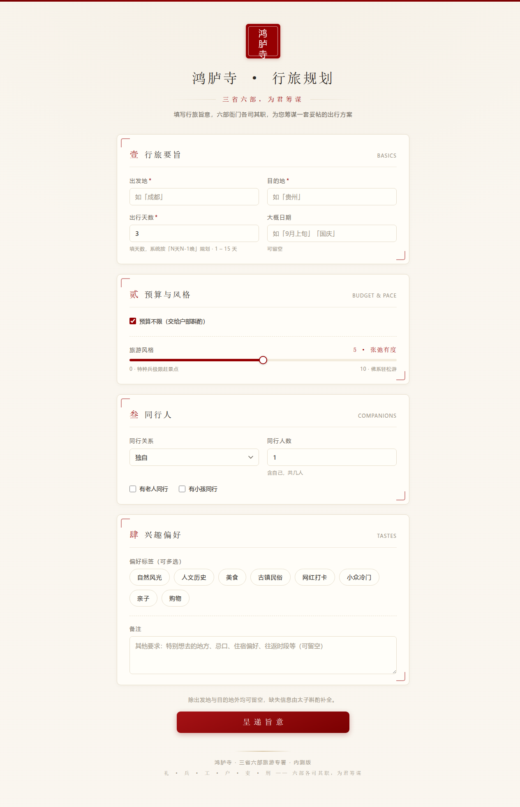
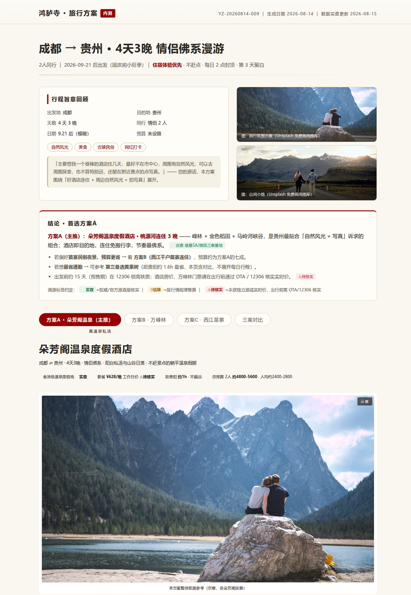
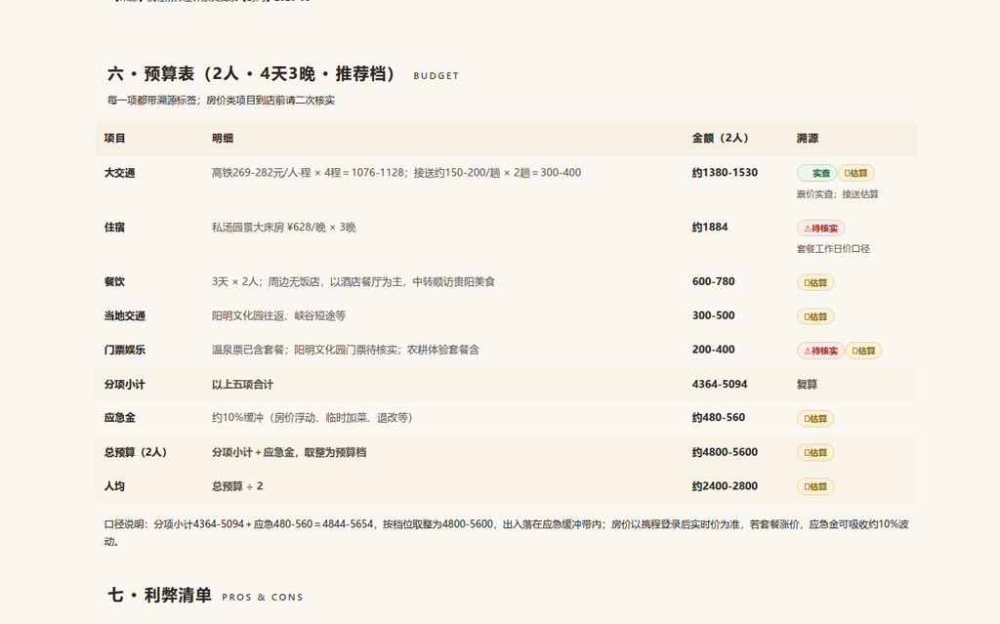
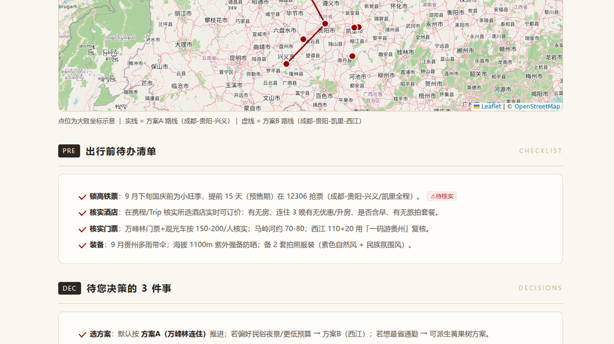

# 鸿胪寺 Honglusi · Multi-Agent Travel Planner

**One form in — a team of specialized AI agents out.**

Submit a rough trip idea ("Chengdu → Guizhou, 4 days, relaxed pace, couple, ~¥5,000") and Honglusi's agent pipeline researches routes, transport, hotels and food, verifies every price, and renders **2–3 complete travel plans as a polished web page** — with an interactive map, day-by-day timeline, itemized budget, and honest pros & cons.

[**▶ Open a live sample plan**](https://12345666ddwa.github.io/honglusi-travel-planner/examples/YZ-20260814-009/plan.html) · [Architecture](docs/architecture.md) · [中文简介](#中文简介)

---

## What makes it different

Most "AI trip planners" are one LLM rewriting its own homework. Honglusi was designed around the opposite: **a pipeline of narrow agents with separated duties, and deterministic verification between them.**

- **Multi-agent pipeline ("Three Departments & Six Ministries")** — intake → five research tracks in parallel → independent verification → drafting → review/veto → render. Sixteen role-specialized agents, each with its own remit and its own output contract.
- **Anti-hallucination by construction** — research agents must emit structured data (not prose); every number carries a source tag (`✅ verified` / `📊 estimated` / `⚠️ unconfirmed`); and deterministic Python validators check budgets, opening hours and route feasibility before anything reaches the page. *The "reviewer" is code, not another LLM.*
- **Deliverable-grade output** — the final plan is a designed web page: plan A/B/C tabs, a Leaflet map with daily routes, transport tables, lodging cards quoting real reviews, an itemized budget, and a three-plan comparison.
- **One-shot form, not a chat** — nearly every field optional; at most 1–2 clarifying questions. No endless back-and-forth.

## Screenshots

### 1 · Input: a single form


### 2 · Output: the rendered plan page

*Plan A header — every claim carries a source tag: ✅ verified / 📊 estimated / ⚠️ to double-check.*


*Itemized budget — each line traces to a source; the total is recomputed by a deterministic validator, not by the LLM.*


*Interactive Leaflet map with the daily route. (The product UI and plans are in Chinese — it is built for domestic travel in China.)*

## How it works

```
form ─▶ Prince (intake) ─▶ State Affairs (dispatch)
                            │
        ┌───────────────────┼─────────────────────────────┐
        ▼                   ▼                             ▼
   Personnel           Revenue · Rites · War · Works    (…)
   (companions)        (budget) (guides) (trains) (routes)
        └───────────────────┼─────────────────────────────┘
                            ▼
                     Justice — deterministic verification + source tagging
                            ▼
                     Secretariat (drafts 2–3 plans) ─▶ Chancellery (review & veto)
                            ▼
                     render the plan page
```

A full description lives in [docs/architecture.md](docs/architecture.md); brief and task-order templates in [docs/brief-template.md](docs/brief-template.md).

## Repository layout

```
├── server/                    FastAPI service + static form page (runs standalone)
├── docs/
│   ├── architecture.md        architecture (EN) · architecture.zh.md (original)
│   ├── brief-template.md      brief & task-order templates (EN)
│   ├── research/              data-source research reports (guides / maps / OSS references)
│   └── screenshots/
├── agents/                    ministry SOUL addenda (agent role definitions)
└── examples/
    └── YZ-20260814-009/       a complete sample job: brief → six-ministry research →
                               draft → veto → final plan page (plan.html)
```

## Quick start

The web service + form + sample plan run anywhere:

```bash
cd server
pip install -r requirements.txt
python -m uvicorn app:app --host 127.0.0.1 --port 8767
# open http://127.0.0.1:8767
```

> The full multi-agent research pipeline needs an agent runtime — the original build orchestrated OpenClaw agents from a Hermes Agent session. The form, the service and the example outputs are standalone.

## Sample job · YZ-20260814-009

The included example is a **real internal test**: Chengdu → Guizhou, 4 days / 3 nights, couple, relaxed pace (~¥5,000 for two). The pipeline produced three candidate plans (hot-spring resort / Wanfenglin karst / Xijiang Miao Village), then verified, vetoed and revised them before rendering the final `plan.html` — every price tagged, every uncertainty flagged. All six ministries' research files are included under `examples/`.

## Status

- **v0.1 — internal test, August 2026.** Form → pipeline → rendered plans working end-to-end; one real trip planned and delivered.
- Roadmap: hosted demo, more data sources, broader regions, partial re-planning from user feedback.

---

## 中文简介

「鸿胪寺」是一个多智能体旅游规划系统：填一次表（出发地 / 目的地 / 天数 / 预算 / 风格 / 同行人），由「三省六部」式流水线上的 16 个角色化 Agent 分工完成攻略采集、预算核算、车次调研、路线测算与独立核验，最终渲染出 2–3 套完整方案网页——带交互地图、逐日行程、分项预算与溯源标签。每条数字都带来源标记（✅实查 / 📊估算），预算与路线由确定性校验器复核，而不是让 LLM 自己检查自己。本仓库为内测版（2026-08），含完整架构文档、样例任务与方案成品页。
